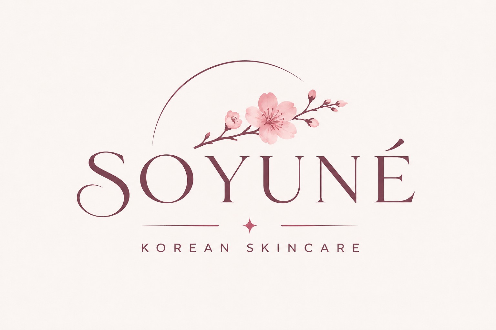

 <div align="center">



# SOYUNÉ — Korean Skincare

### The Art of Skin That Glows.

*A little more care. A little more you.*

A premium Korean skincare e-commerce experience inspired by the elegance of K-beauty, thoughtfully designed to celebrate healthy, hydrated, naturally radiant skin.

</div>

---

## 🌸 About SOYUNÉ

SOYUNÉ is a luxury-inspired Korean skincare storefront that brings together minimal aesthetics, thoughtful product presentation, and a refined digital shopping experience.

Inspired by the philosophy of gentle skincare rituals, the website combines soft blush tones, elegant typography, editorial imagery, and sophisticated layouts to create a premium beauty destination.

Every detail is designed to make skincare feel less like a routine and more like a moment of self-care.

## 💻 Technology Stack

Built using modern web technologies:

- React.js
- JavaScript (ES6+)
- HTML5
- CSS3
- Vite

## ✨ Premium Features

- **Elegant Landing Page** — A visually immersive hero section with premium skincare imagery and refined typography.
- **Curated Collections** — Explore skincare categories including Hydration, Skin Barrier, Brightening, Anti-Aging, Acne & Blemishes, Cleansers, and Lip Care.
- **Premium Product Showcase** — Beautiful product cards featuring high-quality imagery, product descriptions, pricing, and ratings.
- **Smart Product Discovery** — Browse products using category filters, search, price filters, and sorting options.
- **Bestseller Collection** — Discover carefully curated skincare essentials.
- **Wishlist Experience** — Save favourite skincare products for later.
- **Shopping Bag Interface** — A dedicated shopping experience for selected products.
- **Editorial Journal** — Discover skincare insights, Korean glass-skin rituals, hydration guides, and skin barrier education.
- **Featured Product Sections** — Dedicated promotional layouts highlighting signature skincare essentials.
- **Responsive Design** — A polished interface designed to adapt across different screen sizes.
- **Luxury Visual Identity** — Soft blush palettes, muted mauve accents, elegant serif typography, and generous whitespace.

## 🧴 Explore the Collections

| Collection | Description |
|:---|:---|
| 💧 Hydration | Restore moisture and achieve a fresh, dewy appearance. |
| 🌿 Skin Barrier | Support and nourish the skin barrier. |
| ✨ Brightening | Enhance your natural-looking radiance. |
| 🌸 Anti-Aging | Thoughtful skincare focused on skin renewal. |
| 🫧 Acne & Blemishes | Gentle care for clearer-looking skin. |
| 🤍 Cleansers | A refreshing beginning to every skincare ritual. |
| 💋 Lip Care | Keep lips soft, smooth, and nourished. |

## 🎨 Design Philosophy

SOYUNÉ embraces a minimal yet luxurious design language.

- Soft blush and ivory colour palette.
- Elegant editorial-style typography.
- Premium skincare-inspired imagery.
- Clean product grids and balanced spacing.
- Subtle interactive elements and refined details.
- A calm, sophisticated Korean beauty aesthetic.

## 💻 Tech Stack

| Technology | Purpose |
|:---|:---|
| React.js | Component-based user interface |
| JavaScript | Interactive functionality |
| HTML5 | Semantic page structure |
| CSS3 | Styling, layouts, and responsive design |
| Vite | Development server and build tooling |

## 🚀 Getting Started

Follow these steps to run SOYUNÉ locally.

**1. Clone the repository**

```bash
git clone https://github.com/DevyaniVizekar/soyume-korean-skincare.git
```

**2. Navigate to the project directory**

```bash
cd soyume-korean-skincare
```

**3. Install dependencies**

```bash
npm install
```

**4. Start the development server**

```bash
npm run dev
```

Open the local URL displayed in your terminal to explore the website.

## 👩🏻‍💻 Created By

**Devyani Vizekar**

Designed and developed with creativity, attention to detail, and a passion for elegant web experiences.

---

<div align="center">

### SOYUNÉ

*Your skin. Your ritual. Your glow.*

♡ Crafted with care.

</div>
